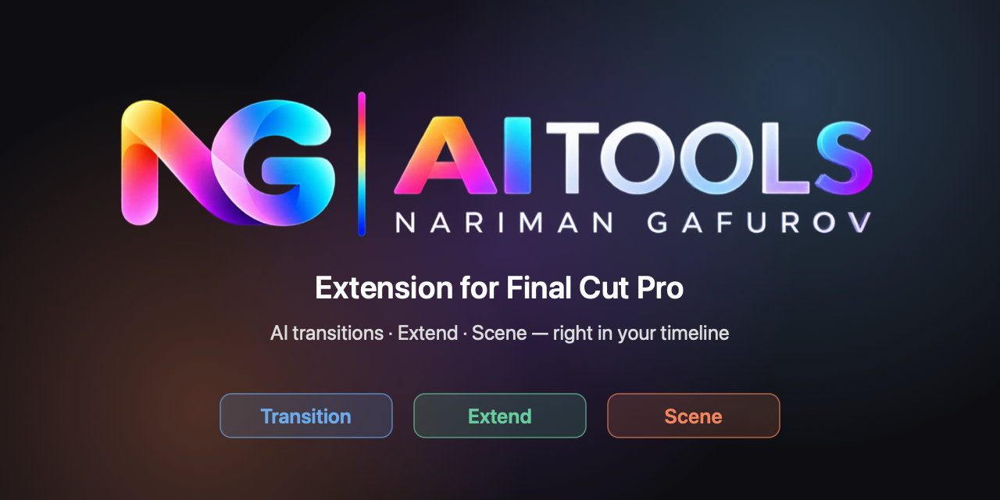
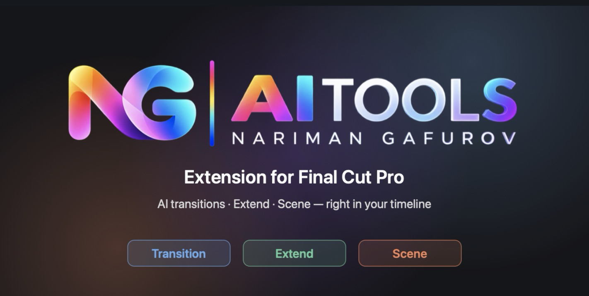
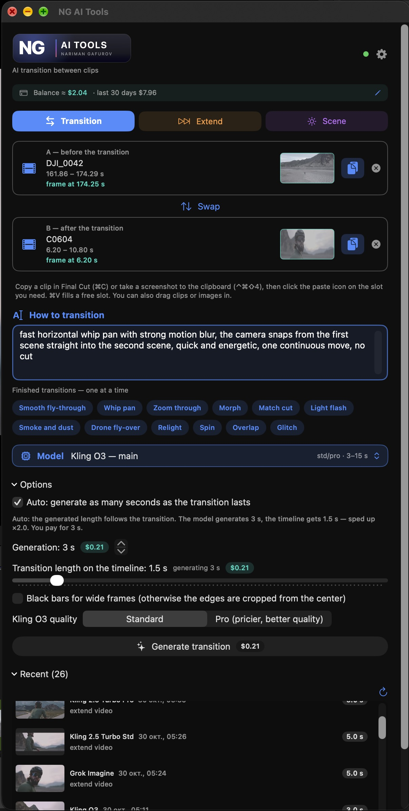
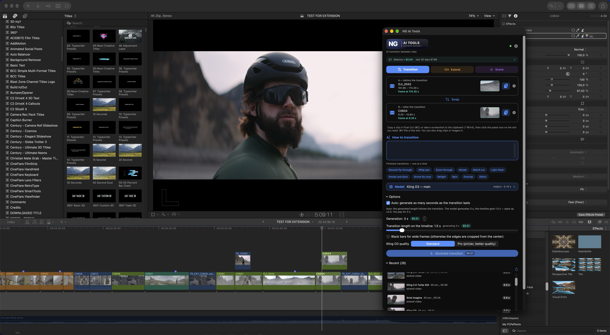
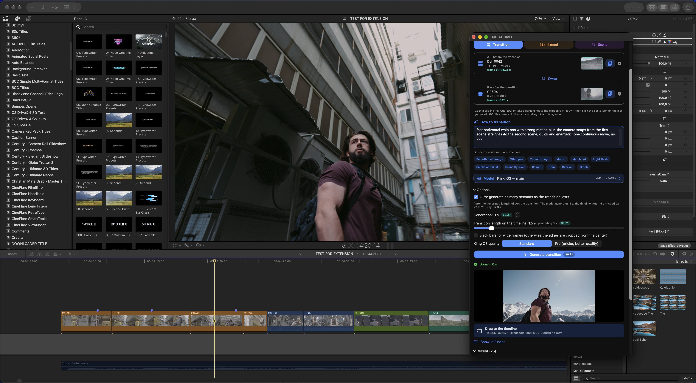

<a href="https://github.com/narimangafurov/ng-ai-tools/releases/latest"><b>⬇ Download the latest NG-AI-Tools .pkg</b></a> · <a href="FAQ.en.md">FAQ</a>

 <a href="https://youtu.be/xFNkEWJM_xs">▶ Watch the demo video</a>

# NG AI Tools for Final Cut Pro (beta)

A small Final Cut Pro **Workflow Extension** that sends frames and short pieces of your timeline clips to AI video models (via the **Higgsfield API**, and optionally the **Google Gemini API**) and brings the result back, ready to drag onto the timeline.

> **Beta, shareware.** The app is free to try for **7 days** with every feature. After that it needs a **serial number** (one serial works on two Macs). Serials are currently given out personally by the author; there is no public store yet. It works on my machine, but there will be bugs, and there is no promise of support or regular updates. Use at your own risk and cost.

## Modes
- **Transition** – copy clip A and clip B in FCP (⌘C), paste them into the panel; the last frame of A and the first frame of B become an AI transition between them. About two dozen ready-made presets (camera moves like dolly, whip pan, fly-through, plus subject effects like ravens, smoke, fire, melt) or your own prompt.
- **Extend** – continue a clip past its last frame (from a frame, cheap; or from the video, smoother).
- **Scene** – replace the background or change the lighting of a clip, with presets.

**Smart presets.** Under the A and B frames the panel shows a short line saying what is in each frame (for example *a person riding a bicycle in a forest*). It is filled in automatically by Apple's built-in Vision recognition, on your Mac, offline, with nothing to install. Presets like Ravens, Morph or Camera pan put those words into the prompt, so the model knows who turns into whom. You can edit the lines by hand or switch the feature off in Settings.

Also: price estimate before every run, Higgsfield balance, several generations in parallel, many models (Kling 3.0 / O3 / Omni, Seedance, Wan, MiniMax… plus **Gemini Omni** straight from Google for Scene and Extend), drag-and-drop of results to the timeline, English and Russian interface.

## Demo

## Requirements
- Mac with **Apple Silicon**, macOS 14+
- Final Cut Pro 11+
- Your own **Higgsfield API key** with a funded balance (you pay Higgsfield per generation, separately from the extension)
- Optional: a **Google AI Studio key** with billing enabled, only if you want the Gemini Omni models (billed by Google directly)

## Install
Download the latest `NG-AI-Tools-…-arm64.pkg` from [Releases](../../releases/latest) (current version: 1.0.2; installing a new one over an old one is fine). The installer is not notarized (no paid Apple Developer account), so macOS will ask you to allow it in **System Settings → Privacy & Security → Open Anyway**. Details and troubleshooting: [FAQ](FAQ.en.md) (also in [Russian](FAQ.ru.md)).

## Trial and serial number
- **First 7 days:** everything works, no serial needed. The panel shows how many days are left.
- **After that:** the panel still opens, but generation is locked until you enter a serial (gear → **Activation**).
- **One serial = two Macs.** Activation needs internet once. Afterwards the app works offline, but it must reach the license server at least once every 14 days (the check runs by itself in the background).
- **How to get a serial:** write to the author (open an Issue, or message @narimangafurov on Instagram). Serials are free for friends and testers during the beta; paid licenses may come later.
- Changed Mac or reinstalled macOS? Ask the author to free a slot.
- The app only sends the serial and an anonymous Mac identifier to the license server, nothing else (no files, no video, no API keys).

## Feedback
Bug reports and ideas are very welcome (open an Issue). Please include the mode and model, the error text or a screenshot, your Mac chip, and macOS / Final Cut versions. Never post your API key.

## Third-party
Includes ffmpeg/ffprobe 9.0.2 (LGPL v2.1+), built unmodified from the official source: https://ffmpeg.org/releases/ffmpeg-9.0.2.tar.xz

