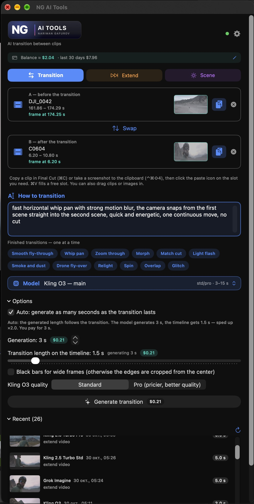
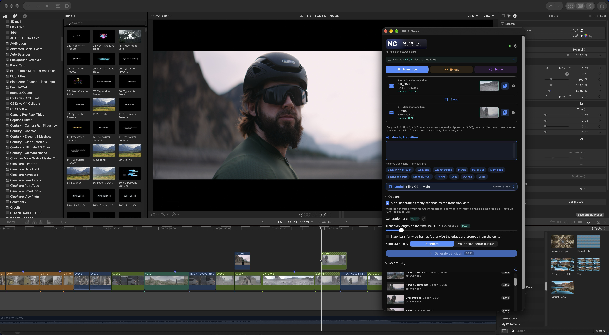
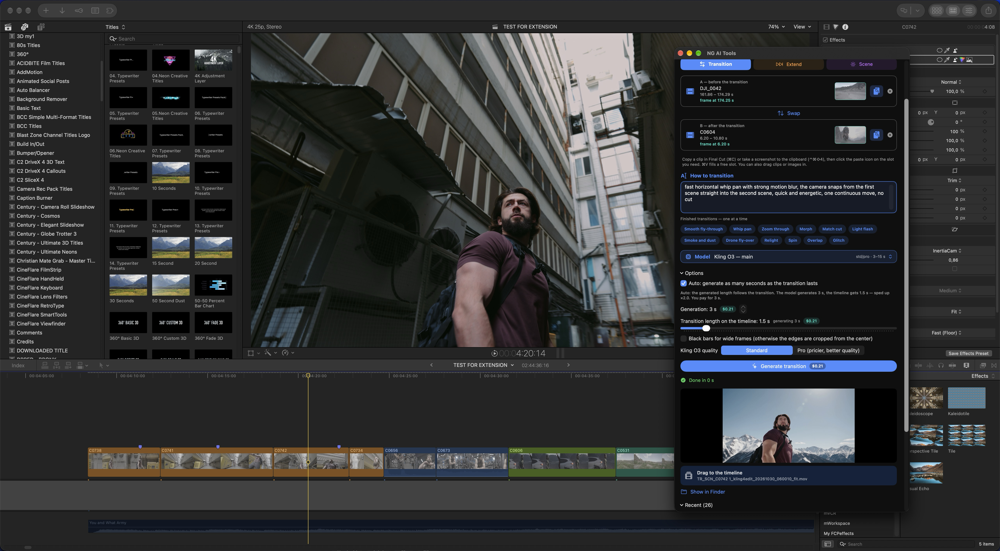

<a href="https://github.com/narimangafurov/ng-ai-tools/releases/latest"><b>⬇ Download NG-AI-Tools-1.0.0-arm64.pkg</b></a> · <a href="FAQ.en.md">FAQ</a>

# NG AI Tools for Final Cut Pro (beta)

A small Final Cut Pro **Workflow Extension** that sends frames and short pieces of your timeline clips to AI video models (via the Higgsfield API) and brings the result back, ready to drag onto the timeline.

> **Test (beta) version.** It works on my machine, but there will be bugs. Shared **as is, free of charge, with no promise of support or regular updates**. Use at your own risk and cost.

## Modes
- **Transition** – copy clip A and clip B in FCP (⌘C), paste them into the panel; the last frame of A and the first frame of B become an AI transition between them. Presets or your own prompt.
- **Extend** – continue a clip past its last frame (from a frame, cheap; or from the video, smoother).
- **Scene** – replace the background or change the lighting of a clip, with presets.

Also: price estimate before every run, Higgsfield balance, several generations in parallel, many models (Kling, Seedance, Wan, MiniMax, Grok…), drag-and-drop of results to the timeline, English and Russian interface.

## Demo

## Requirements
- Mac with **Apple Silicon**, macOS 14+
- Final Cut Pro 11+
- Your own **Higgsfield API key** with a funded balance (you pay Higgsfield per generation; the extension itself is free)

## Install
Download `NG-AI-Tools-1.0.0-arm64.pkg` from [Releases](../../releases). The installer is not notarized (no paid Apple Developer account), so macOS will ask you to allow it in **System Settings → Privacy & Security → Open Anyway**. Details and troubleshooting: [FAQ](FAQ.en.md) (also in [Russian](FAQ.ru.md)).

## Feedback
Bug reports and ideas are very welcome (open an Issue). Please include the mode and model, the error text or a screenshot, your Mac chip, and macOS / Final Cut versions. Never post your API key.

## Third-party
Includes ffmpeg/ffprobe 9.0.2 (LGPL v2.1+), built unmodified from the official source: https://ffmpeg.org/releases/ffmpeg-9.0.2.tar.xz
